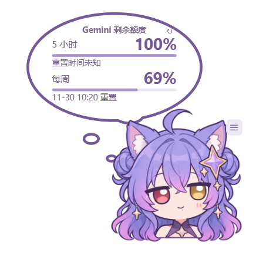
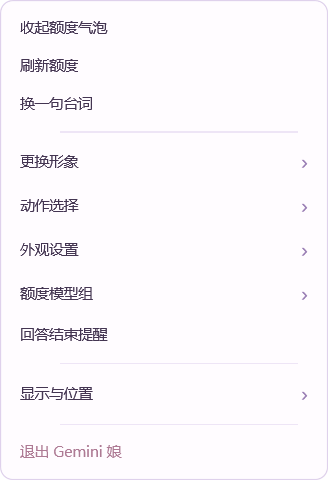
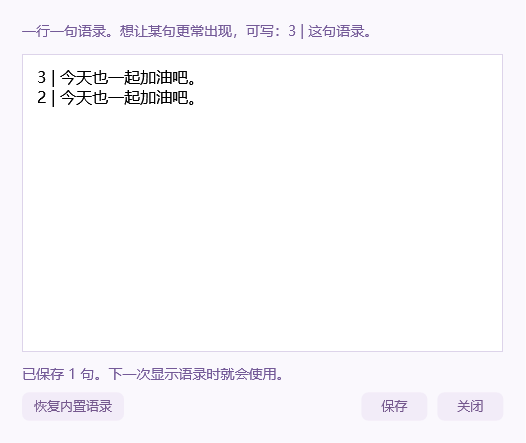
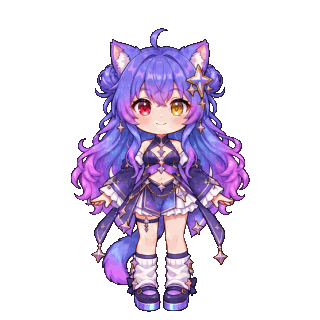

# Gemini-Niang（Gemini 娘）

基于 [T7moris/GPT-Niang](https://github.com/T7moris/GPT-Niang) 的非官方社区 Fork。

**当前交付：Gemini 娘 Windows 桌面适配开发版 v0.3.2。** 包含独立桌面挂件、Antigravity 官方 CLI 额度读取、MCP 工具及 Stop 完成事件桥。角色素材沿用 v0.1.1 的半身近景与正面/侧面/背面全身六姿态，详见[形象修订](docs/bust-v011-revision.md)。

> v0.3.2 新增本地加权语录编辑器与自动语录，修复拖动期间定时定位、桌面位置保存、暂停偏好保存和完成提醒后的气泡恢复。50 项本地测试通过，另含 34 个 WPF UI 断言与 67 个服务断言。详见 [本轮验收](docs/ui-v032/validation.md)；首次真实完成提醒联调见 [v0.3.0](docs/v030-validation.md)。旧 `安装GPT娘.cmd` 仍是 Codex 安装器，新入口为 `安装Gemini娘.cmd`。

## 桌面 UI

下图为真实 WPF 控件渲染，额度为合成测试数据，不是账户余额。

| 思考气泡与角色 | 紫色分组菜单 |
| --- | --- |
|  |  |

已接入形态/动作选择、整体大小、模型组、台词切换、完成提醒开关和跟随模式；已支持本地语录编辑与自动语录。声音、音乐律动及上游自动更新尚未移植，不显示空功能入口。

## 我的语录与自动语录

右键或点击菜单按钮 → **编辑我的语录**：一行一句，也可写 `3 | 台词` 设置权重。每句最多 200 字，重复条目合并权重，连续抽取尽量不重复；保存和恢复内置语录前保留本地备份。自定义语录只保存到 `%LOCALAPPDATA%\GeminiNiang\state\quotes.json`，不上传 GitHub，也不发送给模型。

**自动语录**默认关闭；可选 1/5/15 分钟。仅在挂件可见且气泡收起时显示 8 秒，不打断查看额度、编辑器、菜单、拖动或完成通知；从隐藏、休眠等状态恢复后重新计时，不集中补播。



## Windows 桌面挂件与 Antigravity

需要 Windows 10/11、Node.js 20+、Antigravity App，以及已登录相同账户的 Antigravity CLI 1.1.11+。

1. 将完整仓库保存在长期目录。
2. 双击 **`安装Gemini娘.cmd`**：显式配置 Gemini 娘；缺少 CLI 时下载官方二进制并校验 SHA512，注册本地 Antigravity 插件，然后启动挂件。不改 PATH、计划任务或开机启动。
3. 打开/还原 Antigravity 主窗口；默认跟随模式在主窗口最小化或关闭时隐藏挂件。单击角色查看额度、拖动移动、右键切换形态/动作/大小/桌面模式。
4. 插件安装后，已有聊天可能需要重新加载或新建聊天才会加载 MCP 与 Stop hook。

只验证、不注册插件：

```powershell
.\scripts\Install-GeminiNiang.ps1 -AgyPath 'C:\path\to\agy.exe' -CheckOnly
```

只配置本地桌面程序、不注册全局插件：

```powershell
.\scripts\Install-GeminiNiang.ps1 -AgyPath 'C:\path\to\agy.exe'
.\打开Gemini娘.cmd
```

`停用Gemini娘.cmd` 请求退出挂件并移除 `gemini-niang` 插件，保留偏好。默认状态目录 `%LOCALAPPDATA%\GeminiNiang\state`，与 GPT 娘隔离。更换已有配置前会备份；恢复说明见[适配验收](docs/antigravity-validation.md)。

额度仅调用 `agy -p "/usage" --output-format json`；不创建模型任务，不读取/保存登录令牌或聊天正文。失败与过期显示不可用，不沿用旧余额；1970重置时间视为未知。完成通知仅在 `model_stop` 或当前客户端的 `NO_TOOL_CALL`，且 `fullyIdle=true` 时触发，非逐次模型调用提醒。远程机器/云端运行的 hook 不会自动通知本地桌面。

| 半身 · 招手 | 全身 · 待机 |
| --- | --- |
|  |  |

## 预览与动作选择

需要 Node.js 20+。在仓库目录运行：

```sh
npm ci
npm run preview
```

打开 `http://127.0.0.1:4178/`（仅监听本机）。可切换半身近景、全身正面/侧面/背面，选择待机/眨眼（背面为耳动）/招手/开心/思考/困倦，暂停、调速度/大小/背景，开启减少动态，下载当前PNG/GIF。浏览器保存形态与偏好。

## 动画规格

**AI绘制姿态图集＋程序运动**，不是Live2D或完整连续逐帧骨骼动画。待机切换睁闭眼帧；招手是招手姿态整体轻摇，不宣称手掌独立运动。

- 源图集4张：1536×1024 RGBA、3×2网格。
- PNG24张：512×512、水平对齐、柔和透明边缘。
- GIF24个：320×320、10fps、4秒/40帧、无限循环、单比特透明。
- 全身包含正面、左侧面和背面；背面用耳动替代眨眼，界面有明确标注。

## 文件与验证

- `assets/reference/gemini-turnaround.png`：原始三视图。
- `assets/characters/gemini/`：图集、PNG、GIF、character.json和素材声明。
- `preview/`：角色播放器和动作选择。
- `scripts/build-character.mjs`：分帧、对齐与GIF构建。
- `docs/visual-production-plan.md`：实施计划。
- `docs/asset-provenance.md`：来源与提示词。
- `docs/visual-validation.md`：验收记录及限制。

```sh
npm test
npm run build:character
```

构建使用仓库图集，不调用图像服务。正式界面推荐PNG帧，GIF因色数/透明度限制会损失细节。

## 上游与许可

保留上游历史、MIT版权与素材声明。[上游原始README](README-GPT-Niang.upstream.md)保存原安装与功能说明，不代表已适配Antigravity。

新角色参考由用户提供，来源见[生成记录](docs/asset-provenance.md)；第三方角色、商标与参考图商业权利需另行确认，代码MIT不自动覆盖所有图像，详见[素材声明](assets/characters/gemini/NOTICE.md)。本项目非Google或OpenAI官方产品。
